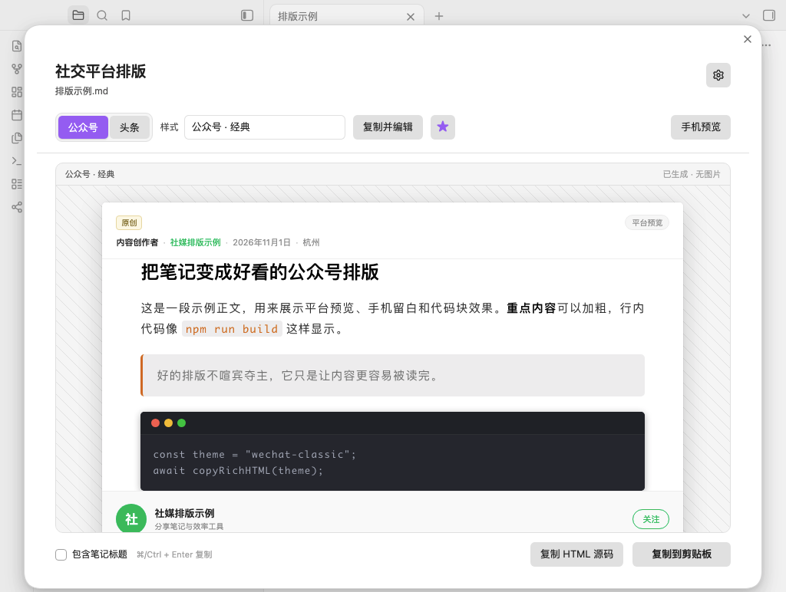

# Social Formatter

[English](README.md) · [中文说明](README.zh.md)

Social Formatter is an Obsidian plugin that converts Markdown notes into WeChat Official Account and Toutiao article styles. Pick a built-in theme or design your own, preview the result, then copy rich HTML straight into the platform editor.

Requires Obsidian 1.13.0 or newer.



## Features

- **Two platforms, four built-in themes**: WeChat Official Accounts (Classic, Fresh Green) and Toutiao (News, Minimal).
- **Paste-ready rich text**: Copy produces inline-styled HTML with no classes or `<style>` tags, so formatting survives the platform editor.
- **macOS-style code blocks**: Code blocks include a red/yellow/green window bar that is also preserved in the copied HTML.
- **Custom themes**: Adjust colors, fonts, type scale, line height, letter spacing, paragraph spacing, headings, quotes, code blocks, radii, and content width. Add your own CSS when needed.
- **Obsidian-aware conversion**: Headings, lists, tasks, quotes, callouts, tables, code blocks, links, tags, footnotes, and local images are converted into portable HTML.
- **Local images**: Vault images are embedded as Base64 so previews and copied content do not depend on local file paths.
- **Live preview**: Switch between desktop and phone widths before copying.
- **Local-first**: Conversion, image embedding, and clipboard writing happen on your machine. The plugin has no telemetry and does not upload note content.

## Installation

### From the community directory

Once the plugin is listed, install it from **Settings → Community plugins → Browse**, search for **Social Formatter**, and enable it.

### Manual installation

1. Build or download `main.js`, `manifest.json`, and `styles.css`.
2. Create this folder in your vault:

   ```text
   <vault>/.obsidian/plugins/social-formatter/
   ```

3. Put the three files in that folder.
4. Open **Settings → Community plugins**, disable Restricted mode, and enable **Social Formatter**.

### Build from source

```bash
npm ci
npm run check
npm run package
```

`npm run package` creates `dist/obsidian-social-formatter-<version>.zip` for local distribution. GitHub Releases contain the three files Obsidian downloads: `main.js`, `manifest.json`, and `styles.css`.

## Usage

1. Open a Markdown note.
2. Click the share icon in the ribbon, or run **Open social preview** from the command palette.
3. Choose WeChat or Toutiao, then pick a theme.
4. Optionally enable **Include note title**. Platform title fields are usually filled separately, so this is off by default.
5. Click **Copy to clipboard**.
6. Paste into the platform editor.

Commands:

- **Copy as WeChat style**
- **Copy as Toutiao style**

If no Markdown note is active, the plugin opens a note picker.

### Default theme

Click the star in the preview toolbar to make the current theme the default. The selected theme is used the next time you open the preview.

### Preview header

The platform header reads optional frontmatter fields: `author`, `account`, `location`, and `published`. Missing values fall back to the plugin metadata and the current date. The header and bottom action bar are preview-only; they are never included in the copied article HTML.

## Built-in themes

### WeChat · Classic

Based on the reading metrics of the [reference WeChat article](https://mp.weixin.qq.com/s/y05u-hdREu2h5YPhzP1MPQ):

- 15 px body, 1.8 line height, 0.08 em letter spacing, justified text
- 22 px bold black section headings
- Orange inline code on a light gray background
- Dark code blocks with rounded corners and a subtle shadow
- Centered, rounded, responsive images

### WeChat · Fresh Green

A modern WeChat theme with a green accent, pill headings, card quotes, and dark code blocks.

### Toutiao · News

Based on the mobile reading metrics of the [reference Toutiao article](https://www.toutiao.com/article/7697815646809227791/):

- 18 px body, 1.72 line height, 12 px paragraph spacing
- 20 px horizontal content padding and 6 px image radius
- Light code blocks and blue links
- Restrained editorial headings

### Toutiao · Minimal

Light code blocks, underlined headings, and card quotes for opinion pieces and long-form writing.

## Custom themes

Open **Settings → Social Formatter**, then use the built-in theme rows or the new-theme row:

- Built-in themes are read-only. Choose **Duplicate and edit** to create an editable copy.
- Create a new WeChat or Toutiao theme from the platform defaults.
- Custom themes can be edited, duplicated, or deleted.
- The editor includes a live sample preview. Changes are saved only when you click **Save theme**.

Editable settings include font family, body size, line height, letter spacing, paragraph spacing, content width, padding, text/heading/accent/background/border colors, heading scale and weight, heading decoration, quote style, code theme, and corner radii.

### Custom CSS

The preview uses a Shadow DOM, so custom CSS cannot leak into the Obsidian interface. Start rules with `.sf-content`:

```css
.sf-content {
  --sf-accent: #7c3aed;
  --sf-accent-soft: #f2ecff;
}

.sf-content h2 {
  letter-spacing: 0.08em;
}

.sf-content p {
  text-indent: 2em;
}
```

The copy step reads the final computed styles and writes them as inline `style` attributes. Normal CSS rules for typography, color, spacing, borders, backgrounds, and shadows are preserved.

Available CSS variables:

```text
--sf-accent          --sf-accent-soft     --sf-text
--sf-heading         --sf-strong          --sf-muted
--sf-bg              --sf-border          --sf-font
--sf-font-size       --sf-line-height     --sf-letter-spacing
--sf-paragraph-gap   --sf-content-width   --sf-heading-weight
--sf-strong-weight   --sf-h1-size         --sf-h2-size
--sf-h3-size         --sf-radius          --sf-image-radius
```

Useful classes:

```text
.sf-content          .sf-title            .sf-code-block
.sf-quote            .sf-table            .sf-callout
.sf-callout-title    .sf-task-list        .sf-checkbox
.sf-tag              .sf-math             .sf-figure
.sf-image            .sf-align-center     .sf-align-right
```

Limitations:

- Pseudo-elements (`::before` / `::after`) are preview-only and are not copied.
- Layout rules that depend on viewport width, `position`, `float`, or flex/grid may not survive the platform editor.

## Images, links, and platform limits

- Local images are embedded as Base64. Some platform editors do not upload Base64 images automatically; re-insert the image if it is missing after pasting.
- Remote images keep their original URL. If the platform blocks hotlinks, re-upload the image manually.
- The per-image size limit is configurable in settings (8 MB by default). Images over the limit are skipped with a warning.
- A Markdown image `title` becomes a caption:

  ```markdown
  
  ```

- For Obsidian wiki images, `![[image.png|300]]` uses `300` as the image width.
- External links keep their URL and styling. WeChat article links are often not clickable; this is a platform limitation.
- Internal links are converted to plain text.
- Formulas are reduced to copyable text. Mermaid, Excalidraw, and Canvas content is replaced with a placeholder.
- Embedded notes are not recursively expanded. Videos, audio, and iframes are removed.

## Permissions and network use

- **Vault enumeration**: when no Markdown note is active, the plugin lists Markdown files (`vault.getMarkdownFiles`) so you can choose a note to format. It reads only the selected note and the local images it references.
- **Clipboard**: the plugin writes rich HTML and plain text to the system clipboard only when you click a copy button. It does not read the clipboard.
- **Network**: the plugin does not upload notes, send telemetry, or make background network requests. If a note references a remote image, the preview loads that image URL directly.
- **Files outside the vault**: none.

## How it works

1. Read the active note, including unsaved editor changes when available.
2. Remove frontmatter and comments, resolve images, and embed local images.
3. Render Markdown with Obsidian's `MarkdownRenderer`, then normalize the result into portable HTML.
4. Apply the selected theme CSS inside a Shadow DOM for live preview.
5. On copy, walk the preview, read computed styles, and write inline styles to every element.
6. Write `text/html` and `text/plain` to the clipboard, falling back to plain text when rich clipboard writes are restricted.

## Development

```text
.github/workflows/       CI and release workflows
scripts/                 Version check and packaging scripts
src/
  main.ts                Plugin entry, commands, note picker, direct copy
  exporter.ts            Rendering, computed styles, inline HTML, clipboard export
  markdown.ts            Markdown preprocessing and image tokens
  images.ts              Image resolution and Base64 embedding
  normalize.ts           Obsidian output to portable social HTML
  themes.ts              Built-in themes, theme CSS, sample content
  clipboard.ts           Rich/plain clipboard writing
  ui/PreviewModal.ts     Preview, platform and theme switching, copy
  ui/ThemeEditorModal.ts Custom theme editor
  ui/SettingsTab.ts      Settings and theme library
```

```bash
npm run typecheck
npm test
npm run build
npm run check
```

Node 22 is the supported development version (`.nvmrc`).

## GitHub Actions and releases

- **CI** runs on pushes to `main`/`master`, pull requests, and manual dispatches. It installs dependencies, validates version metadata, runs typecheck and tests, builds the plugin, and uploads the plugin plus zip as a CI artifact.
- **Release** runs on version tags. It validates the tag, runs the full check, builds `main.js`, generates GitHub artifact attestations, and publishes a GitHub Release with `main.js`, `manifest.json`, and `styles.css`. The zip stays in CI artifacts and local builds; it is not attached to the release.

The release tag must exactly match `manifest.version`; do not prefix it with `v`.

```bash
node scripts/verify-version.mjs 0.1.2
git tag -a 0.1.2 -m "0.1.2"
git push origin 0.1.2
```

## Submit to the Obsidian community directory

Obsidian now accepts submissions at [community.obsidian.md](https://community.obsidian.md), not through a pull request to `obsidian-releases`. See the official [Submit your plugin](https://docs.obsidian.md/plugins/releasing/submit-plugin) guide.

Before submitting:

- The GitHub repository must be public and contain `README.md`, `LICENSE`, and `manifest.json` at the root.
- The manifest ID must be unique, cannot contain `obsidian`, and should match the plugin folder name.
- `version` must use `x.y.z`, and must match `package.json`, `versions.json`, and the GitHub Release tag.
- The release must include `main.js`, `manifest.json`, and `styles.css`.
- If the plugin uses Node.js or Electron APIs, `isDesktopOnly` must be `true`.

To submit:

1. Push the repository to GitHub's default branch.
2. Create the version tag and let the Release workflow publish the GitHub Release.
3. Sign in to [community.obsidian.md](https://community.obsidian.md) with an Obsidian account.
4. Connect your GitHub account in your profile.
5. Go to **Plugins → New plugin**, enter the repository URL and owner.
6. Accept the Developer policies and submit for review.
7. Fix any review findings, increment the version, and publish a new GitHub Release. The directory will check the new version.

After approval, users can install the plugin from **Settings → Community plugins → Browse**. Future updates only require a new GitHub Release.

Official references:

- [Manifest](https://docs.obsidian.md/Reference/Manifest)
- [Submission requirements for plugins](https://docs.obsidian.md/community-directory/submission-requirements-for-plugins)
- [Developer policies](https://docs.obsidian.md/community-directory/developer-policies)

## Known limitations

- Only WeChat Official Accounts and Toutiao are built in. The theme system is platform-agnostic and can be extended.
- Platform editors filter some CSS. Colors, type, spacing, borders, and backgrounds are usually stable; complex layouts are not guaranteed.
- Rich clipboard access depends on system permissions. In rare cases the plugin falls back to plain text.
- Image upload behavior depends on the platform. The plugin does not call platform publishing APIs.

## License

MIT
