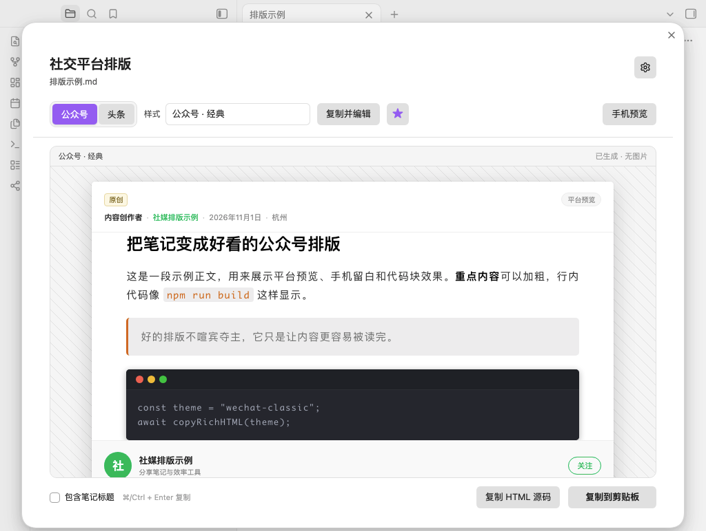
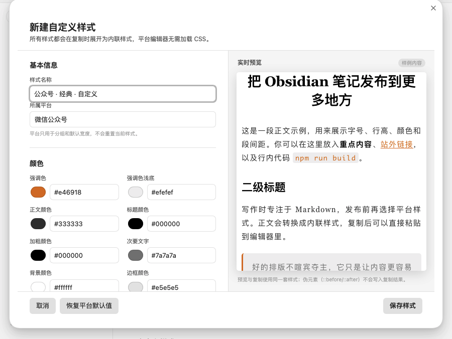

# Social Formatter · Obsidian 社媒排版插件

[English](README.md) · 中文

把 Obsidian 笔记转换成微信公众号、今日头条的排版样式。预览满意后点一下复制，直接把富文本粘贴到平台编辑器里，不用重新排一遍。



## 功能

- **两个平台的内置样式**：微信公众号（经典、清新绿）、今日头条（资讯、简约）。
- **真正的复制粘贴**：生成只含内联样式的 HTML，不依赖 `<style>` 或 class，粘贴到平台编辑器后样式仍然存在。
- **自定义样式**：在插件里调整颜色、字体、字号、行高、字距、段距、标题装饰、引用、代码主题、圆角等参数，也可以写自定义 CSS。
- **保留 Obsidian 语义**：标题、列表、任务、引用、Callout、表格、代码块、图片、链接、标签、脚注等会转换成适合社交平台的 HTML。
- **本地图片内嵌**：`![[image.png]]` 和 `` 会读取为 Base64 一起复制，避免预览时图片丢失。
- **两种工作流**：打开预览仔细挑选样式，或用命令直接按默认样式复制。
- **实时预览**：支持手机宽度预览；预览中看到的就是复制出去的内容。
- **本地处理**：转换、图片内嵌和复制都在本地完成，不上传笔记内容。插件本身不发起网络请求；如果笔记引用远程图片，预览时会由 Obsidian 直接加载该图片 URL。

## 安装

### 手动安装

1. 下载或构建出 `main.js`、`manifest.json`、`styles.css`。
2. 在笔记库中创建目录：

   ```text
   <你的笔记库>/.obsidian/plugins/social-formatter/
   ```

3. 把三个文件放进该目录。
4. 打开 Obsidian → 设置 → 第三方插件，关闭安全模式，启用 **Social Formatter**。

### 从源码构建

```bash
npm install
npm run build   # 生成 main.js
npm test        # 运行单元测试
npm run package # 生成 dist/obsidian-social-formatter-0.1.1.zip
```

开发时可以使用：

```bash
npm run dev
```

然后在本仓库目录和 Obsidian 插件目录之间建立软链接，或把构建产物复制过去。

## 使用

### 预览后复制

1. 打开一篇 Markdown 笔记。
2. 点击左侧边栏的分享图标，或执行命令 **“打开社媒排版预览”**。
3. 在弹窗顶部选择 **公众号 / 头条**，再选择样式。
4. 需要时打开 **“包含笔记标题”**（公众号和头条通常在后台单独填写标题，默认关闭）。
5. 点击 **“复制到剪贴板”**。
6. 到公众号或头条的编辑器里直接粘贴。

也可以复制 HTML 源码，交给其他富文本编辑器或自己的发布流程。

### 直接复制命令

命令面板中提供：

- `复制为公众号样式`
- `复制为今日头条样式`

如果当前没有打开 Markdown 笔记，会先让你选择一篇。

### 设为默认

在预览右上角点击星标，可以把当前样式设为默认。下次打开预览、或使用直接复制命令时优先使用它。

## 内置样式

### 公众号 · 经典

参考 [公众号样式文章](https://mp.weixin.qq.com/s/y05u-hdREu2h5YPhzP1MPQ) 的阅读参数制作：

- 正文 `15px`，行高 `1.8`，字距 `0.08em`，两端对齐
- 二级标题 `22px` 加粗，黑色
- 行内代码橙色 `#e46918`，浅灰底
- 深色代码块 `#282c34`，圆角和轻微阴影
- 图片居中、圆角、自适应宽度

### 公众号 · 清新绿

更现代的公众号样式：绿色强调色、胶囊标题、卡片引用、深色代码块。适合产品、工具、教程类文章。

### 头条 · 资讯

参考 [今日头条样式文章](https://www.toutiao.com/article/7697815646809227791/) 的移动端阅读参数制作：

- 正文 `18px`，行高 `1.72`，段间距 `12px`
- 内容两侧留白 `20px`，图片圆角 `6px`
- 浅色代码块、蓝色链接
- 标题保持资讯阅读的克制感

### 头条 · 简约

浅色代码、下划线标题、卡片引用，适合观点、故事和长文。

## 自定义样式



设置 → **Social Formatter** → **样式库**：

- 内置样式不可直接修改，点击 **复制并编辑** 会创建一份独立的自定义样式。
- **新建公众号样式** / **新建头条样式** 从平台默认样式开始。
- 自定义样式支持编辑、复制、删除。
- 编辑器里有实时样例预览，修改后保存才会写入设置。

可调整的参数包括：

- 字体、字号、行高、字距、段间距、内容宽度、上下左右留白
- 正文颜色、标题颜色、加粗颜色、强调色、强调浅色、背景、边框
- 标题字号、H1/H2/H3 字号、标题字重、加粗字重、标题装饰
- 引用样式、代码主题、圆角、图片圆角
- 自定义 CSS

### 自定义 CSS 的作用域

预览在 Shadow DOM 中渲染，自定义 CSS 不会污染 Obsidian 界面。要覆盖文章样式，建议从 `.sf-content` 开始写：

```css
.sf-content {
  --sf-accent: #7c3aed;
  --sf-accent-soft: #f2ecff;
}

.sf-content h2 {
  letter-spacing: 0.08em;
}

.sf-content p {
  text-indent: 2em;
}
```

复制时会读取浏览器计算后的最终样式，逐元素写成内联 `style`，所以普通 CSS 规则（包括颜色、字体、间距、边框、背景、阴影等）会一起复制。

### 可用的 CSS 变量

```text
--sf-accent          --sf-accent-soft     --sf-text
--sf-heading         --sf-strong          --sf-muted
--sf-bg              --sf-border          --sf-font
--sf-font-size       --sf-line-height     --sf-letter-spacing
--sf-paragraph-gap   --sf-content-width   --sf-heading-weight
--sf-strong-weight   --sf-h1-size         --sf-h2-size
--sf-h3-size         --sf-radius          --sf-image-radius
```

### 常用类名

```text
.sf-content          .sf-title            .sf-code-block
.sf-quote            .sf-table            .sf-callout
.sf-callout-title    .sf-task-list        .sf-checkbox
.sf-tag              .sf-math             .sf-figure
.sf-image            .sf-align-center     .sf-align-right
```

### 注意

- 伪元素（`::before` / `::after`）只会在预览中显示，不会写入复制结果。
- 依赖视口宽度的布局、`position`、`float`、`flex/grid` 这类排版不会可靠地带到平台编辑器；复制结果会按平台正文宽度自适应。
- 自定义 CSS 越大，复制出的 HTML 越大，但普通文章一般可以接受。

## 图片、链接与平台限制

### 图片

- 本地图片会以 Base64 内嵌，预览和复制都不依赖本地文件路径。
- 远程图片保留原 URL。
- 很多平台编辑器不会自动上传 Base64 图片。如果粘贴后图片显示为占位或丢失，请在平台编辑器里重新插入图片。
- 单张图片上限可以在设置中调整（默认 8 MB）。超过上限的图片会被跳过，并在预览里提示。
- Markdown 图片的 `title` 会变成图注，例如：

  ```markdown
  
  ```

- Obsidian 的 `![[image.png|300]]` 会使用 `300` 作为图片宽度。

### 链接与标签

- 外部链接保留 `href` 和样式。公众号正文里的站外链接通常不可点击，这是平台限制。
- 内部链接（`[[笔记]]`）会变成普通文字，避免复制出无效的 `app://` 地址。
- `#标签` 会保留为强调文字。

### 复杂内容

- 公式会转换为文本形式；平台编辑器一般不能保持 MathJax / KaTeX 排版。
- Mermaid、Excalidraw、Canvas 会替换为 `[图表]` 占位符。
- 嵌入的笔记不会递归展开，而是显示为“嵌入笔记”文字，并在预览里提示。
- 视频、音频、iframe 等媒体不会复制。

## 权限与网络

- **Vault 枚举**：当没有打开 Markdown 笔记时，插件会调用 `vault.getMarkdownFiles()` 列出所有 Markdown 文件，用于选择要排版的笔记；选中后才读取该笔记和它引用的本地图片。
- **剪贴板**：只有点击复制按钮时才会写入富文本和纯文本，不读取剪贴板内容。
- **网络**：插件不上传笔记、不发送遥测、不发起后台网络请求。若笔记引用了远程图片，预览会直接加载该图片 URL。
- **Vault 外文件**：不访问。

## 工作原理

1. 读取当前笔记；如果编辑器里有未保存修改，会优先使用编辑器里的内容。
2. 预处理 Markdown：去掉 frontmatter 和注释，解析图片，内嵌本地图片。
3. 用 Obsidian 的 `MarkdownRenderer` 渲染，再把结果整理成语义更干净的 HTML。
4. 在 Shadow DOM 中套用主题 CSS，实时预览。
5. 复制时遍历预览中的元素，读取计算样式，逐元素写成内联 `style`，并去掉 class、data 属性、脚本等无关内容。
6. 通过 `ClipboardItem` 写入 `text/html` + `text/plain`；失败时使用选区复制或纯文本回退。

## 开发

```text
.github/workflows/       CI 与 Release 工作流
scripts/                 版本校验与打包脚本
src/
  main.ts                 插件入口、命令、文件选择、直接复制
  exporter.ts             渲染、计算样式、内联 HTML、剪贴板导出
  markdown.ts             Markdown 预处理、图片 token 化
  images.ts               图片解析、Base64 内嵌
  normalize.ts            Obsidian 渲染结果 -> 社交平台 HTML
  themes.ts               内置主题、主题 CSS、样例内容
  clipboard.ts            富文本/纯文本剪贴板
  ui/PreviewModal.ts      预览、平台与样式切换、复制
  ui/ThemeEditorModal.ts  自定义样式编辑器
  ui/SettingsTab.ts       设置页与样式库
```

常用命令：

```bash
npm run typecheck
npm test
npm run build
npm run check
```

## GitHub Actions 与发布

仓库内置两条 GitHub Actions 工作流：

- **CI**（`.github/workflows/ci.yml`）：push 到 `main` / `master`、Pull Request 或手动触发时，安装依赖、校验版本号、运行类型检查与单元测试、构建插件包，并上传构建产物。
- **Release**（`.github/workflows/release.yml`）：推送与 `manifest.version` 完全一致的版本标签（例如 `0.1.1`）时，再次运行完整检查，生成构建证明，然后把 `main.js`、`manifest.json`、`styles.css` 附加到 GitHub Release。安装包 zip 只保留在 CI Artifacts 和本地构建中，不附加到 Release，避免目录提示不受支持的文件。

### 发布新版本

版本号需要同时更新：

- `package.json` 的 `version`
- `manifest.json` 的 `version`
- `versions.json` 中对应版本号，以及 `manifest.minAppVersion`

然后本地校验（这里的 `0.1.1` 要换成实际的新版本号）：

```bash
node scripts/verify-version.mjs 0.1.1
```

提交并推送后创建标签：

```bash
git tag -a 0.1.1 -m "0.1.1"
git push origin 0.1.1
```

**注意：** Obsidian 按 `manifest.version` 精确查找 GitHub Release 的 tag，因此不要使用 `v0.1.1` 这类带前缀的标签；tag 必须写成 `0.1.1`。

如果还没有配置远程仓库：

```bash
git remote add origin git@github.com:<你的用户名>/<仓库名>.git
git push -u origin main
```

标签推送后，Action 会校验 tag 与 `manifest.version` 是否一致，测试和构建通过后自动创建 GitHub Release，并为三个发布资产生成 GitHub artifact attestation。安装包 zip 会在 CI 的 Artifacts 中保留 14 天。

## 发布到 Obsidian 社区插件目录

Obsidian 现在的提交入口是 [community.obsidian.md](https://community.obsidian.md)，不再需要给 `obsidian-releases` 仓库提 PR。完整官方流程见 [Submit your plugin](https://docs.obsidian.md/plugins/releasing/submit-plugin)。

### 提交前检查

- GitHub 仓库必须公开，根目录包含 `README.md`、`LICENSE`、`manifest.json`。
- `manifest.json` 的 `id` 必须唯一，且不能包含 `obsidian`；本项目使用 `social-formatter`。
- `version` 必须是 `x.y.z` 格式，并与 `versions.json`、`package.json` 保持一致。
- 如果使用了 Node.js / Electron API，`isDesktopOnly` 必须设为 `true`。本项目使用 Web Clipboard API，移除了 Electron fallback，因此保持 `false`。
- GitHub Release 的 tag 必须与 `manifest.version` 完全一致，并附带 `main.js`、`manifest.json`、`styles.css`。

### 提交步骤

1. 把代码提交并推送到 GitHub 默认分支。
2. 按上面的发布流程创建版本标签，让 Release 工作流生成 GitHub Release。
3. 打开 [community.obsidian.md](https://community.obsidian.md)，用 Obsidian 账号登录。
4. 在 Profile 中连接 GitHub 账号，用于验证仓库所有权。
5. 进入 **Plugins → New plugin**，填写 GitHub 仓库 URL 和 Owner。
6. 阅读并同意 Developer policies，提交审核。
7. 自动审核发现的问题会显示在目录中；修复后提升版本号并发布新的 GitHub Release，目录会按新版本重新检查。

审核通过后，用户就可以在 Obsidian 的社区插件市场中直接搜索并安装。后续更新只需发布新的 GitHub Release，不需要重复提交。

## 已知限制

- 目前只内置公众号和今日头条两个平台。主题结构是平台无关的，后续可以继续增加平台预设。
- 平台编辑器会过滤部分 CSS。颜色、字号、行高、间距、边框、背景通常稳定；复杂布局和动画不保证。
- 复制富文本需要系统剪贴板权限。极端情况下会退化为纯文本，并给出提示。
- 图片能否自动上传取决于平台，插件不直接调用平台发布 API。

## License

MIT
